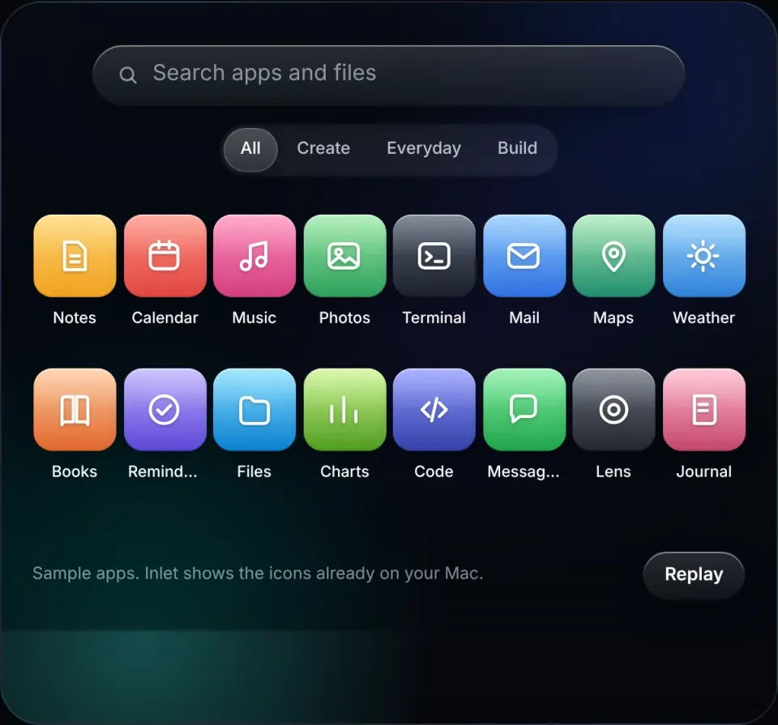

<p align="center">
  <picture>
    <source media="(prefers-color-scheme: dark)" srcset="website/assets/inlet-wordmark-dark.svg">
    
  </picture>
</p>

<p align="center">
  <strong>Every app and file on your Mac, one keystroke away.</strong><br>
  A native macOS launcher for macOS 26 Tahoe and later, built to replace the Launchpad that Apple removed.
</p>

<p align="center">
  <a href="https://freezingshock.github.io/Inlet/"></a>
</p>

<p align="center">
  <a href="https://github.com/FreezingShock/Inlet/releases/latest/download/Inlet.dmg"><strong>Download for Mac</strong></a>
  &nbsp;·&nbsp;
  <a href="https://freezingshock.github.io/Inlet/">Website</a>
  &nbsp;·&nbsp;
  <a href="CHANGELOG.md">Changelog</a>
  &nbsp;·&nbsp;
  <a href="docs/launchpad-parity.md">Launchpad parity</a>
</p>

---

## What it does

Inlet opens the way Launchpad did, with the features you'd expect and a few you wouldn't.

- **Full-screen grid.** Every app in `/Applications`, `~/Applications` and `/System/Applications`, with its real icon, in a grid you can page through.
- **Groups.** Sort apps into groups such as Create, Build, School, Everyday, Games and Other. Make your own with a name, a color and an SF Symbol icon. Right-click any app to move it.
- **Search that finds files too.** Type anywhere to filter apps, then see matching files from Spotlight. Return opens the top hit.
- **A global hotkey and a Quick Panel.** Open Inlet from anywhere, or click the Dock icon to get a small panel with recent apps and files.
- **Hide what you don't use.** Hide third-party apps from the grid, and restore them from the Hidden button.
- **Trackpad gestures.** Swipe between pages, pinch in on the desktop to open, or set a hot corner.
- **Native from top to bottom.** Standard menus, pop-up pickers, switches, alerts and keyboard focus, with Liquid Glass where macOS uses it.

Inlet has no accounts and no tracking. The one network call is an update check, and you can turn it off in Settings.

## Install

1. Download `Inlet.dmg` from [the latest release](https://github.com/FreezingShock/Inlet/releases/latest), or from the [website](https://freezingshock.github.io/Inlet/).
2. Open the disk image and drag **Inlet** into **Applications**.
3. Open Inlet. The first time, macOS may say it can't verify the app. Open **System Settings > Privacy & Security**, scroll to the message about Inlet, and choose **Open Anyway**.

Inlet can check for updates in the background. You can turn that off in Settings.

## Build it yourself

You need macOS 26 or later and Xcode 26 or later. No paid Apple Developer account is required.

1. Clone the repo, or download it from **Code > Download ZIP**.
2. Double-click `Inlet.xcodeproj`.
3. Make sure the scheme is **Inlet** and the destination is **My Mac**.
4. Press **Command-R**.

If Xcode asks for a development team, choose **Signing & Capabilities** on the Inlet target and pick **Sign to Run Locally**.

To keep Inlet running after you close Xcode, choose **Product > Show Build Folder in Finder**, open `Products/Debug`, and drag `Inlet.app` into Applications.

## Settings

Open Settings with **Command-,**. The panes match System Settings.

| Pane | What you set |
|---|---|
| General | Open at login, the menu bar icon, closing after a launch, Escape behavior, remembering the last group |
| Keyboard | Shortcuts for Show all apps and the Quick Panel. Press a new one to record it |
| Appearance | Auto, Light or Dark |
| Grid | Columns, pinch to open, the hot corner, F4 to open the grid |
| Search | Whether files are included, and how many file results to show |
| Quick Panel | What a Dock click opens, and how many recent apps and files to list |
| Privacy | Erasing launch history (Recent apps and files) |
| About | The version, the last scan, and the update check |

## Design

Inlet uses the system's own controls wherever macOS has one, so it behaves like the rest of your Mac:

- **Menus and pop-ups** for choices such as a group's color and the hot corner.
- **Popovers** for the Groups and Hidden panels, which close on an outside click the way other menus do.
- **Alerts** before anything is deleted.
- **SF Symbols** for every icon, so they match the system weight and scale.
- **System colors** for group colors, which adapt to Light, Dark and Increase Contrast.
- **Liquid Glass button styles** for the header, Restore and Undo.

Inlet's own palette and type scale still set the brand surfaces: the grid background, the search field and the group bar. They come from a single source, [`design/tokens.json`](design/tokens.json). After you edit it, run:

```sh
python3 scripts/build-tokens.py
```

CI runs the same script with `--check`, so the Swift tokens and the website stay in step with the JSON.

## Code map

| Path | What it does |
|---|---|
| `Inlet/InletApp.swift` | The app entry point, the menus and File > Reload Apps |
| `Inlet/AppDelegate.swift` | Dock clicks, the hotkey, and which surface opens |
| `Inlet/Models/` | Apps, categories, groups and the library the grid reads |
| `Inlet/Layout/` | The saved grid layout: groups, order, hidden apps |
| `Inlet/Services/` | Scanning, launching, icons, hotkeys, the menu bar item, recents, file search, the overlay window |
| `Inlet/Views/AppGridView.swift` | The full-screen grid, its header and its popovers |
| `Inlet/Views/Grid/` | Grid geometry, tiles, page dots, trackpad paging, Hidden apps and Undo |
| `Inlet/Views/Groups/` | The group bar, the Groups popover, group colors and the Move to Group menu |
| `Inlet/Views/QuickPanel/` | The Dock-anchored Quick Panel |
| `Inlet/Views/SearchPanel.swift` | The search field and results |
| `Inlet/Settings/` | The Settings window and its panes |
| `Inlet/Onboarding/` | The first-run walkthrough |
| `Inlet/Updates/` | Sparkle update checks and the Updates section |
| `Inlet/Diagnostics/` | Feedback and the diagnostics report |
| `InletTests/` | Unit tests for scanning, search, layout, groups and the hot corner |
| `website/` | The static site and its assets |
| `scripts/` | Token builds, website checks, release packaging and the launch art |
| `docs/` | Launchpad parity, the accessibility audit, auto-updates and deployment notes |

## Docs

- [Launchpad parity](docs/launchpad-parity.md): what classic Launchpad did, what Inlet does, and what still needs a check on a Mac
- [Accessibility audit](docs/accessibility-audit.md)
- [Auto-updates](docs/auto-updates.md)
- [Performance](PERFORMANCE.md)
- [Releasing](RELEASING.md) and [Contributing](CONTRIBUTING.md)

## Status

Inlet is in active development. Most of the v1 scope is in: the grid with pages, edit mode, groups, hidden apps, search with files, the Quick Panel, the global hotkey, and automatic updates. Work still open is tracked in the issues and in [CHANGELOG.md](CHANGELOG.md).

## Privacy

Everything stays on your Mac. Inlet doesn't ask for an account, doesn't track you, and doesn't send your app list or files anywhere. Its only network request is the update check, which you can turn off.

## License

Inlet is released under the MIT License. See [LICENSE](LICENSE).
