<p align="center">
  <picture>
    <source media="(prefers-color-scheme: dark)" srcset="docs/readme/icon-dark.png">
    
  </picture>
</p>

<p align="center">
  <picture>
    <source media="(prefers-color-scheme: dark)" srcset="docs/readme/wordmark-dark.svg">
    
  </picture>
</p>

<p align="center">
  <strong>Every app, one keystroke away.</strong><br>
  The full-screen app grid Apple took away, back on your Mac.
</p>

<p align="center">
  <a href="https://github.com/FreezingShock/Inlet/releases/latest/download/Inlet.dmg">
    
  </a>
</p>

<p align="center">
  macOS 26 or later &nbsp;·&nbsp; Free &nbsp;·&nbsp; Open source (MIT)
</p>

<p align="center">
  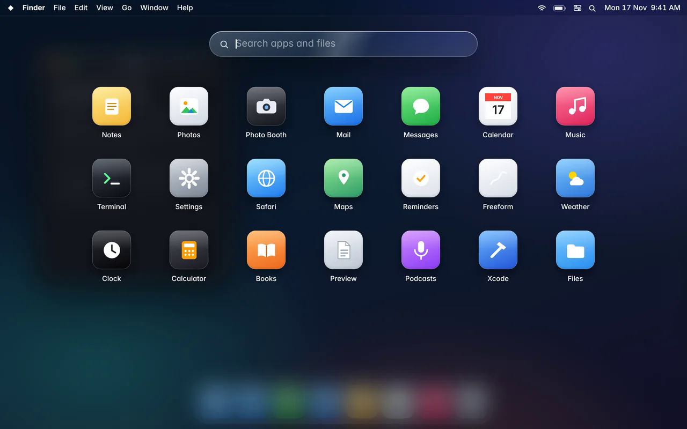
</p>

---

## Install

Inlet installs like any other Mac app. You don't need an account, and there's nothing to set up first.

1. **Download** Inlet with the button above. You get a file called `Inlet.dmg`.
2. **Open** the disk image and drag **Inlet** onto **Applications**.
3. **Open Inlet** from Applications. Apple doesn't check Inlet yet, so macOS stops the first launch. Click **Done**.
4. Open **System Settings**, go to **Privacy & Security**, scroll down, and click **Open Anyway** next to Inlet. Enter your password. Inlet opens, and you won't see this again.

<p align="center">
  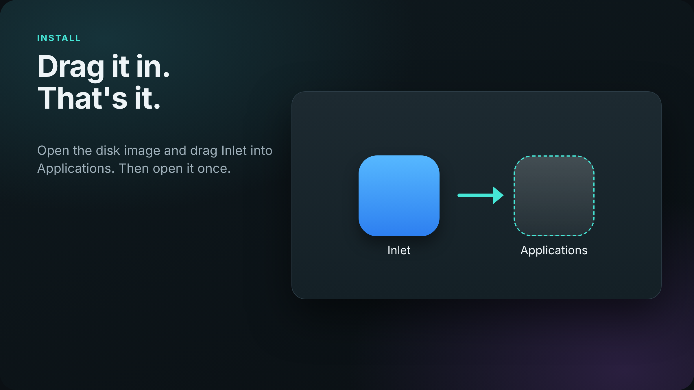
</p>

If the Open Anyway button disappears, try opening Inlet once more and it will come back.

Requires macOS 26 or later.

---

## Features

<p align="center">
  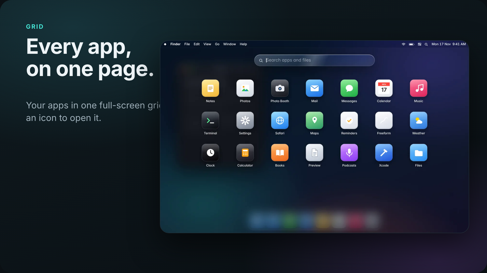
</p>

**Every app, in one grid.** Inlet shows all the apps on your Mac with their own icons. Click one to open it. Press Escape or click outside to close the grid. You can swipe between pages on the trackpad, and pinch to open it.

<p align="center">
  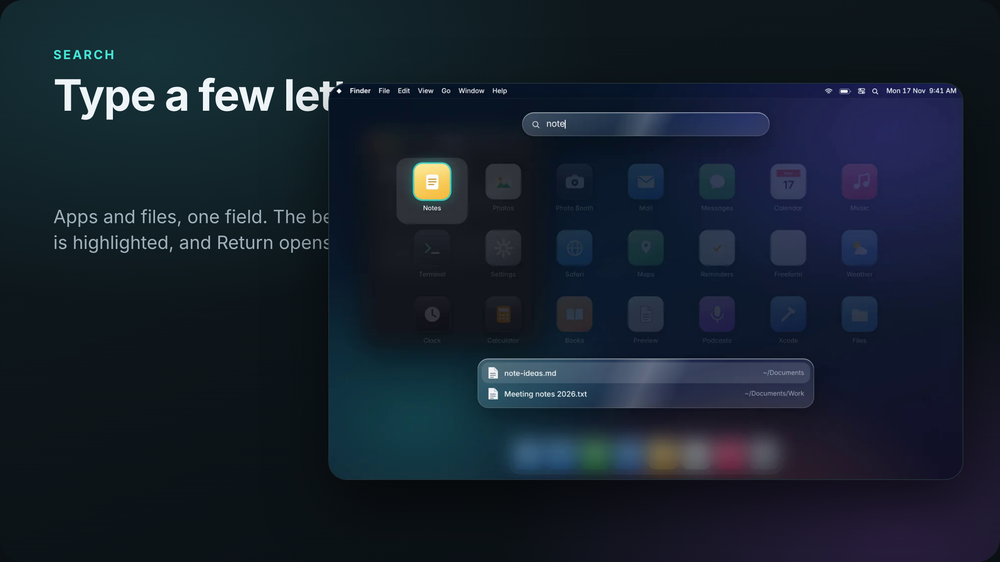
</p>

**Search for anything.** Start typing and the grid narrows down. The best match is highlighted, and matching files show up underneath. Press Return to open the top match, or Command Return to show a file in Finder.

<p align="center">
  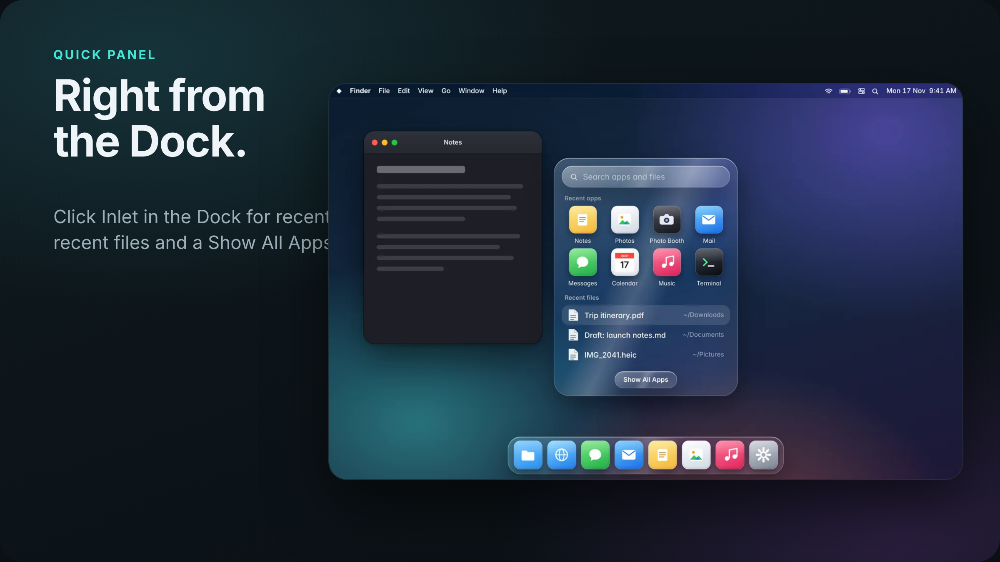
</p>

**A quick panel from your Dock.** Click the Inlet icon in the Dock to see your recent apps and files, with one button to open the full grid. You choose how many recent apps and files to show.

<p align="center">
  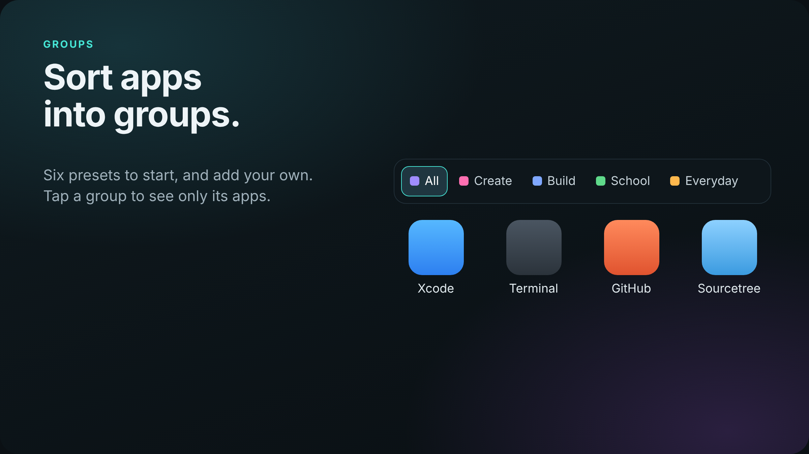
</p>

**Groups.** Sort your apps into groups like Create, Build, School, Everyday, Games, and Other. Tap a group to see only its apps. Make your own groups too, and name them, color them, and put them in the order you like. Right-click any app to move it to another group.

<p align="center">
  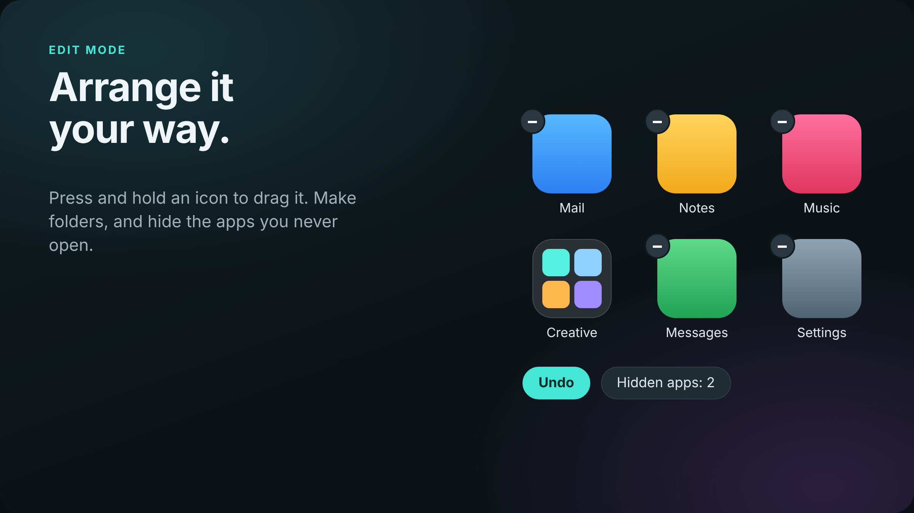
</p>

**Arrange it your way.** Press and hold an icon to move it. Put related apps in a folder, up to nine apps each. Hide any app you don't use by tapping the small minus badge, and bring it back later from the hidden list. Apple's own apps can't be hidden. Your layout is saved on your Mac.

<p align="center">
  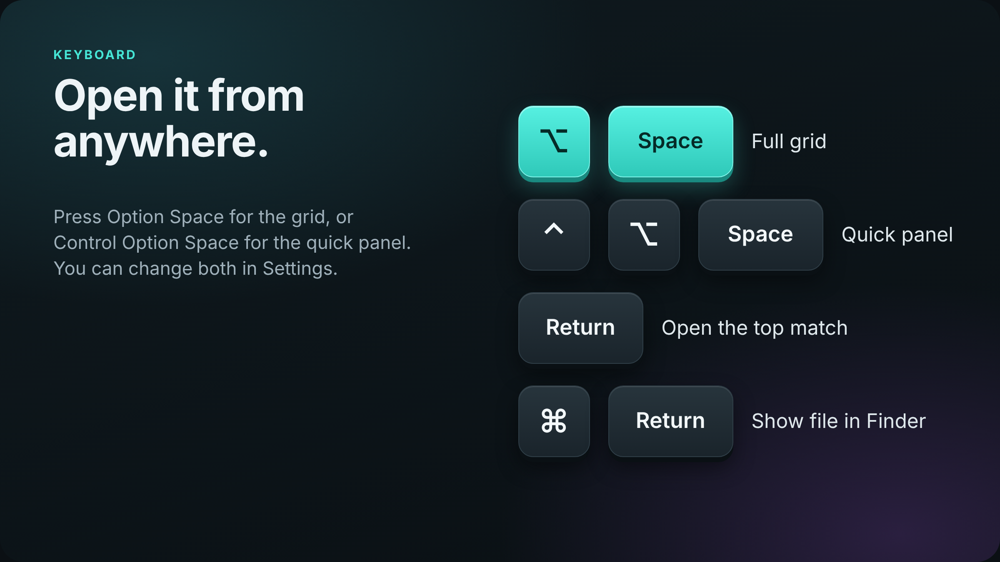
</p>

**Keyboard first.** <kbd>⌥</kbd> <kbd>Space</kbd> opens the grid from anywhere. <kbd>⌃</kbd> <kbd>⌥</kbd> <kbd>Space</kbd> opens the quick panel. <kbd>F4</kbd> also opens the grid. <kbd>Esc</kbd> clears your search first and closes the grid when the search is empty. You can change any of these in Settings.

<p align="center">
  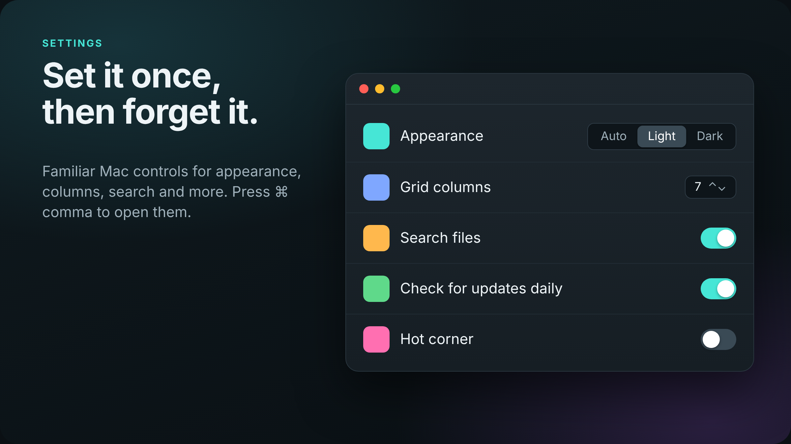
</p>

**Settings that feel like a Mac.** Pick Light, Dark, or Auto for the appearance. Choose 5 to 9 grid columns. Decide whether search includes files. Turn update checks on or off. Press <kbd>⌘</kbd> <kbd>,</kbd> to open Settings.

<p align="center">
  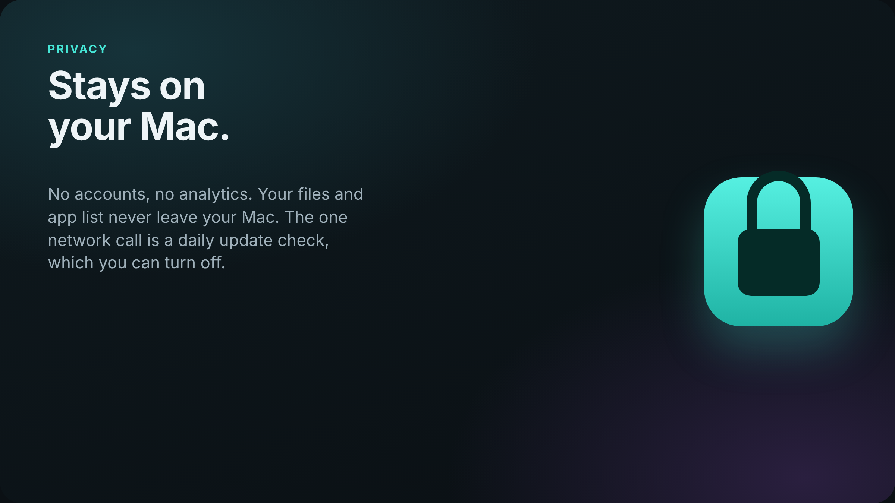
</p>

**Stays on your Mac.** Inlet has no account and no analytics, and it doesn't upload your files or your list of apps. Your recent items, groups, and layout are saved only on your Mac. The one network call is a daily check for updates, and you can turn it off in Settings.

---

## Supporter

<p align="center">
  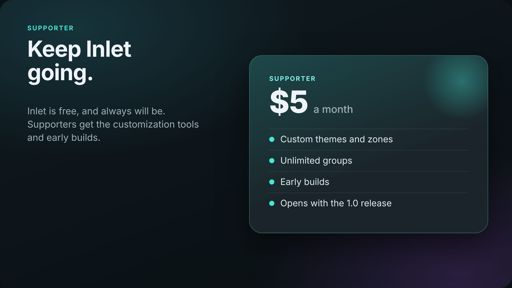
</p>

Inlet is free, and the whole app is included. If you want to help keep it going, you can become a **Supporter** for **$5 a month** through [GitHub Sponsors](https://github.com/sponsors/FreezingShock).

Supporters get the customization tools (custom themes and zones) and early builds a few weeks before each release. Supporter opens with the 1.0 release. Building Inlet from source stays free.

---

## Build it yourself

<details>
<summary>Build from source (for developers)</summary>

You need macOS 26 and Xcode 26.

```sh
git clone https://github.com/FreezingShock/Inlet.git
cd Inlet
open Inlet.xcodeproj
```

In Xcode, choose the **Inlet** scheme and **My Mac**, then press <kbd>⌘</kbd> <kbd>R</kbd>. If Xcode asks for a development team, open **Signing & Capabilities** for the Inlet target and choose **Sign to Run Locally**. Press <kbd>⌘</kbd> <kbd>U</kbd> to run the tests.

</details>

---

## Privacy

Your data stays on your Mac. Inlet doesn't upload your files or your app list, and it has no analytics or tracking. The only network call is a daily update check to GitHub, and you can turn it off in Settings.

Inlet never sends a crash or feedback report on its own. Those open a GitHub issue in your browser, and you decide what to post.

---

## License

Inlet is open source under the [MIT License](LICENSE). Read it, change it, and build it for any purpose.

---

<p align="center">
  <sub>Inlet is an independent project by FreezingShock. It is not made by, endorsed by, or affiliated with Apple Inc.</sub>
</p>
