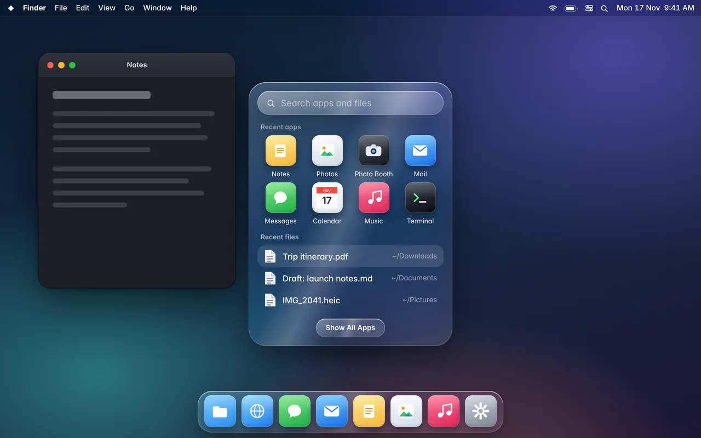
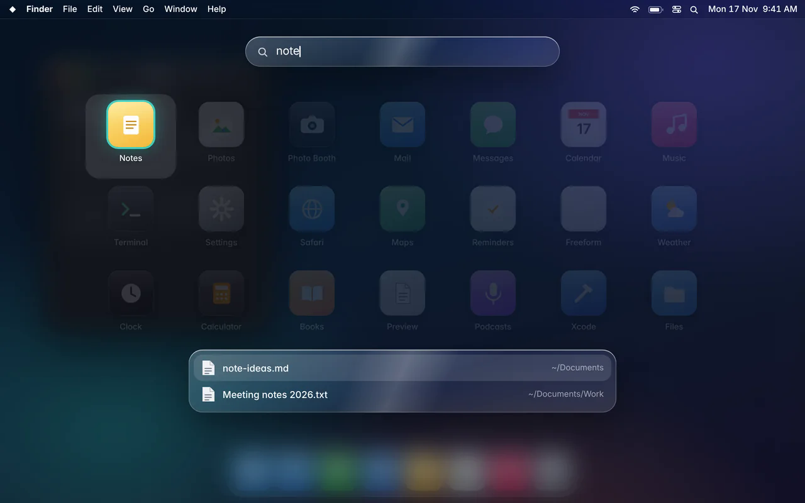

<p align="center">
  <picture>
    <source media="(prefers-color-scheme: dark)" srcset="docs/readme/icon-dark.png">
    
  </picture>
</p>

<p align="center">
  <picture>
    <source media="(prefers-color-scheme: dark)" srcset="docs/readme/wordmark-dark.svg">
    
  </picture>
</p>

<p align="center">
  <strong>Every app, one keystroke away.</strong><br>
  A full-screen app grid and search for your Mac, built to replace Launchpad.
</p>

<p align="center">
  <a href="https://github.com/FreezingShock/Inlet/releases/latest/download/Inlet.dmg">
    
  </a>
</p>

<p align="center">
  macOS 26 or later &nbsp;·&nbsp; MIT licensed &nbsp;·&nbsp; No accounts, no tracking
</p>

<p align="center">
  
</p>

Apple removed Launchpad in macOS 26 Tahoe. Inlet brings the full-screen grid back and adds one search field for apps and files. Your apps, files and layout stay on your Mac.

<p align="center">
  
  
</p>

## Features

**Grid.** Every app in `/Applications`, `~/Applications` and `/System/Applications` shows up with its own macOS icon. Click one to open it. Escape or a click outside closes the grid. Swipe between pages on the trackpad, or pinch to open the grid. Pinch and F4 are on by default.

**Search.** Start typing and the grid filters as you go. The best match is highlighted, and matching files from Spotlight appear underneath. Inlet keeps no index of its own, so anything Spotlight can find, Inlet can find.

**Edit mode.** Press and hold an icon to rearrange the grid. Group related apps into folders, up to nine apps each. Tap the minus badge to hide a third-party app. Apple's built-in apps can't be hidden. Undo is one tap away, and hidden apps come back from the Hidden list.

**Groups.** Six presets (Create, Build, School, Everyday, Games and Other) sit in a bar above the grid. Tap one to filter the grid to it. Add your own, then rename, recolor, re-icon and reorder them. Right-click an app to move it to another group.

**Quick panel.** Click Inlet's Dock icon, or press <kbd>⌃</kbd><kbd>⌥</kbd><kbd>Space</kbd>, for a small panel with recent apps, recent files and a Show All Apps button. Show 4, 8 or 12 recent apps and 0 to 5 recent files. A Dock click can open the full grid instead if you prefer.

**Accessibility.** Inlet follows Reduce Motion, Reduce Transparency and Increase Contrast from your Mac's settings. Nothing needs to be set up inside Inlet.

## Keyboard

| Keys | What it does |
| --- | --- |
| <kbd>⌥</kbd> <kbd>Space</kbd> | Open the full grid. Change it in Settings › Keyboard. |
| <kbd>⌃</kbd> <kbd>⌥</kbd> <kbd>Space</kbd> | Open the quick panel. |
| <kbd>F4</kbd> | Open the grid. On by default. |
| <kbd>Return</kbd> | Open the top match. |
| <kbd>⌘</kbd> <kbd>Return</kbd> | Show the top file in Finder. |
| <kbd>↑</kbd> <kbd>↓</kbd> <kbd>←</kbd> <kbd>→</kbd> | Move through results. |
| <kbd>Esc</kbd> | Clear the search first, then close. |

While Inlet is running, <kbd>⌥</kbd><kbd>Space</kbd> belongs to Inlet everywhere, so it won't type a non-breaking space in text fields. Change the shortcut if that gets in your way.

## Settings

Open Settings with <kbd>⌘</kbd><kbd>,</kbd>. It uses standard macOS controls, so it works the way the rest of your Mac does.

| Pane | Controls |
| --- | --- |
| General | Open at login, menu bar icon, close after launch, Escape behavior |
| Keyboard | The grid and quick panel shortcuts. Press the keys you want, or Esc to cancel. |
| Appearance | Light, Dark, or Auto (follows your Mac) |
| Grid | Columns, 5 to 9 (7 by default) |
| Search | Include files, and how many (0 to 8) |
| Quick Panel | Dock click action, recent apps and recent files |
| Privacy | Erase launch history |
| About | Version, apps found, last scan, update checks |

## Install

Requires macOS 26 or later.

1. Click **Download for Mac**. You get `Inlet.dmg`.
2. Open the disk image and drag **Inlet** into **Applications**.
3. Open Inlet. macOS says it can't verify the app, because Inlet isn't notarized by Apple. Click **Done**.
4. Open **System Settings › Privacy & Security**, scroll to **Security**, and click **Open Anyway** next to Inlet. Confirm with your password, then open Inlet again.

The Open Anyway button stays available for a short time after the first attempt. If it's gone, try opening Inlet again.

Prefer Terminal? Run this once, then open Inlet normally:

```sh
xattr -dr com.apple.quarantine /Applications/Inlet.app
```

Inlet is free and open source. Notarizing it needs a paid Apple Developer account, and the project doesn't use one.

## Build from source

Requires macOS 26 and Xcode 26.

```sh
git clone https://github.com/FreezingShock/Inlet.git
cd Inlet
open Inlet.xcodeproj
```

In Xcode, choose the **Inlet** scheme and **My Mac**, then press <kbd>⌘</kbd><kbd>R</kbd>. If Xcode asks for a development team, open **Signing & Capabilities** for the Inlet target and choose **Sign to Run Locally**. Press <kbd>⌘</kbd><kbd>U</kbd> to run the tests.

## Supporter

Inlet is free, and the whole app is included with no sign-in. Supporter is **$5 a month** through [GitHub Sponsors](https://github.com/sponsors/FreezingShock). It pays for the customization tools (custom themes and zones) and for early builds. Supporter opens with the 1.0 release. Building from source is always free.

## Privacy

Inlet has no accounts, analytics or tracking. Your recent items, groups, layout and settings are saved on your Mac, and Inlet doesn't upload your files or your app list.

The only network call is an update check to GitHub, once a day. You can turn it off in Settings. Inlet never sends a crash or feedback report on its own. Those open a GitHub issue in your browser, and you decide what to post.

## License

Inlet is released under the [MIT License](LICENSE). Read it, change it, and build it for any purpose.

---

Inlet is an independent project by FreezingShock. It is not made by, endorsed by, or affiliated with Apple Inc.
